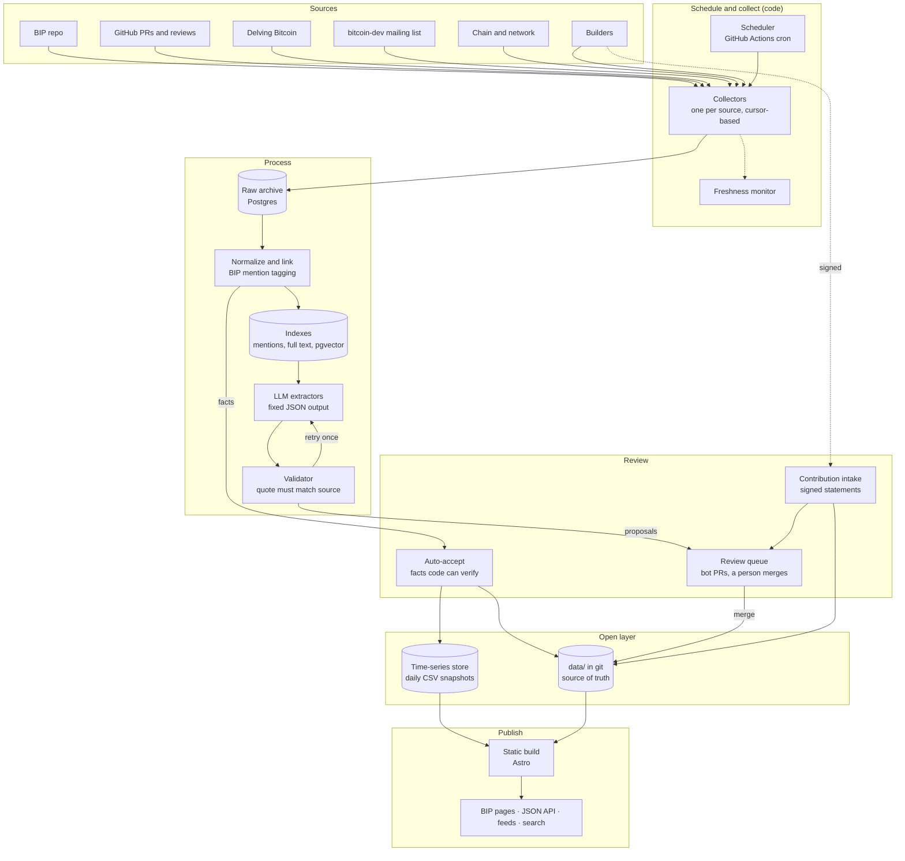

# BipWatch: product and technical spec

This is the handoff document for anyone, human or coding agent, picking up BipWatch. It records what the project is, what has been decided and why, what exists in this repo today, and what to build next with acceptance criteria.

Read it top to bottom once. After that, section 6 (next work) is the part you will come back to.

Last updated 2026-11-05, at commit `26c3993`.

---

## 1. What BipWatch is

BipWatch (bipwatch.com) makes Bitcoin Improvement Proposals easier to understand, evaluate and contribute to.

It is an **open layer of data, metadata and evidence on top of the BIP repository** (github.com/bitcoin/bips). The BIP repo holds the specs. BipWatch adds sourced context around each spec: what problem it solves and how well that problem is evidenced, who is implementing it, what objections and open questions exist, who has taken a position, and what the proposal still needs.

That layer is rendered through **stage templates**, so each page answers the question that matters for the proposal's stage of life.

### Principles

These came out of the design work and should constrain every implementation decision.

1. **Nothing public without a source.** Every claim links to where it came from and carries a short verbatim quote as proof. The statement is BipWatch's reading; the quote is the evidence.
2. **Code first, LLMs only for language.** Anything a program can determine on its own (status, dates, authors, signaling counts, mentions of a BIP number) is done in code. LLMs only read prose: stances, objections, summaries.
3. **People approve, machines propose.** Automated output reaches the public record only after a person merges it, except facts that code can verify alone.
4. **Consensus is not a vote.** Never show support percentages. Show who has spoken, what they said, how verifiable it is, and who has not spoken.
5. **Low maintenance.** Static site, scheduled jobs, one database. No servers to babysit beyond what is strictly needed.
6. **Open by default.** Data is CC0, the API is the same data the site uses, and anyone can fork the record.

### Initial scope: six BIPs

Three consensus proposals (one big) and three faster wins. Picks so far:

- **BIP 352** Silent Payments (applications layer; seeded in this repo)
- **BIP 353** (pairs with 352 as one of the faster wins)
- **BIP 54** Consensus Cleanup (consensus)
- **BIP 448** covenants / vaults (consensus)
- Two more to be chosen

---

## 2. Concepts

### Official BIP statuses (BIP 3)

`Draft`, `Complete`, `Deployed`, `Closed`. BipWatch stores the official status untouched, then adds its own classification.

### BipWatch categories (user-facing)

Stored in `bip.yaml` as `bipwatch.category`. They exist because the four official statuses do not tell a reader the practical state of a proposal.

| Category | Typical official status | Meaning |
|---|---|---|
| `idea` | none yet / Draft | Is this a real problem? |
| `in-development` | Draft | Spec still moving, needs review |
| `needs-consensus` | Complete, Layer is a consensus change | Only consensus (activation) is missing |
| `ready-to-build` | Complete | Can ship wallet by wallet or node by node |
| `live-patchy-adoption` | Deployed | Shipped but adoption is uneven |
| `standard-everywhere` | Deployed | Broadly supported |
| `fading` | Deployed | Officially live, but the ecosystem is moving away (e.g. BIP 70, 37, 125) |
| `closed-replaced` | Closed | Withdrawn or superseded |

### Stage templates

Stored as `bipwatch.template`. Each template is one page layout answering one question. The **layer** changes what a stage means: "deployed" for a soft fork means activation plus onchain usage; for BIP 352 it means wallet coverage, because silent payment outputs cannot be told apart onchain. That is recorded as `bipwatch.adoption_measure`.

| Template | Question | Modules (planned) |
|---|---|---|
| `idea` | Is this a real problem? | Problem-evidence board, prior-art lineage |
| `draft` | Is the design converging? | Spec-stability chart, review heatmap by section, design-space map of competing proposals, author heartbeat |
| `complete` | Is it getting built? | Implementation matrix, test-vector conformance, interop matrix, adoption funnel; consensus signaling module for consensus-layer BIPs |
| `deployed` | How much is it used? | Adoption curve, errata log, "built on this" dependency graph |
| `closed` | Why did it end? | Post-mortem card, revival signals |

Every template also shows the **needs assessment** (below). Only `complete` is implemented so far.

### Needs assessment

Six dimensions, each scored 0 to 5 (5 = no help needed, `null` = not enough evidence to score). Every score must cite claim ids from the same BIP. Optional `help_wanted` lists concrete asks for contributors.

`problem_evidence`, `technical_maturity`, `ux_exploration`, `implementations`, `ecosystem_awareness`, `coordination`.

### Consensus signaling module (designed, not built)

For BIPs in `needs-consensus`. Design decisions already made:

- Rows are stakeholder groups: protocol devs and reviewers, miners and pools, economic nodes (exchanges, custodians, processors), wallets and apps, L2 and protocol builders, node operators and users.
- Vocabulary is Bitcoin Core's review language: Concept ACK, Approach ACK, ACK, NACK, conditional (condition stated), needs research, no public position. Objections get their own list with status open / addressed / disputed.
- Signals are ranked by verifiability: (1) onchain or network data, (2) signed attestations (nostr, PGP, BIP-322), (3) sourced public statements, (4) unverified sentiment, shown separately and never counted.
- Every signal is pinned to a spec version. When the spec changes materially, earlier signals are flagged as possibly stale.
- Show coverage ("4 of the 10 largest pools have said anything"), not support ratios.
- Economic node identity and weight: published reserve addresses with BIP-322 signatures are the strongest mechanism. Self-reported volumes and node counts are unreliable; exclude them or show ranges.
- v1 ships only sourced statements and signed attestations.
- **First version built (2026-11-06)**, `site/src/components/Positions.astro`, on the `complete` template as "Who has taken a position". It shows stance claims only (sourced statements; no signed attestations, chain data or stakeholder groups yet), in three blocks: positions on the proposal (latest per person, earlier ones listed under it), on changes to the spec, and on implementations (grouped by pull request or discussion thread, collapsed, newest first). No counts per stance and no colours that read as a score. Each position shows its quote, source, review state and the spec version it was made against; proposal positions get a "spec changed since" flag when the spec's MAJOR or MINOR version moved after them (BIP 352's changelog makes PATCH non-material). Not yet: stakeholder groups, coverage ("4 of the 10 largest pools"), who has not spoken, objections with status alongside.

---

## 3. Architecture

Git holds the truth, Postgres holds the work, the site is static.



### Decisions

| Question | Decision | Why |
|---|---|---|
| Source of truth | YAML files in `data/`, JSON Schema checked in CI | Versioned, reviewable, forkable; review happens as pull requests |
| Database | One Postgres (managed, with pgvector) | Working memory only: raw archive, job state, indexes, time series. Never queried by the site. Rebuildable from sources plus `data/` |
| Indexes | BIP-mention index (code), Postgres full text, pgvector embeddings; Pagefind for public search | No separate search engine or vector DB |
| LLM use | Small single-purpose functions with structured JSON output. One retry on validation failure, then drop and log | Every claim must be traceable to a quote; no autonomous agent writes to the record |
| Review | Bot opens one PR per BIP per run against `data/`; merge is approval | Public audit trail, no admin UI to build |
| Jobs | GitHub Actions scheduled workflows in v1 | Free, logged, no server. Move to a worker with pg-boss when anything needs to run every few minutes |
| Site | Astro, static output, React islands later for charts | Nothing to run in production |
| Hosting | Cloudflare Pages (not yet wired) | Static CDN; Workers later for intake |
| Chain data | Public explorer API for headers, crawler data for node versions in v1 | Own Bitcoin Core node with ZMQ once an activation is live |
| Language | TypeScript end to end | Shared types between collectors, schemas and site |

### Job cadences (proposed)

| Job | Trigger | Cadence |
|---|---|---|
| BIP repo fetch | schedule | 30 min |
| GitHub reviews and issues | schedule | hourly |
| Delving Bitcoin | schedule | 30 min |
| Mailing list | schedule | hourly |
| Chain headers (version bits) | schedule, only while a deployment signals | 10 min |
| Node versions | schedule | daily |
| LLM extraction | new linked items | hourly batch |
| Spec-change check | commit touching a tracked BIP | on event |
| Weekly digest draft | schedule | weekly |
| Site build | merge to main, plus nightly | on event |

---

## 4. What exists in this repo

```
data/                       open data layer (CC0)
  schemas/                  bip, claim, needs (JSON Schema 2020-12)
  bips/0352/                tracked: bip.yaml, needs.yaml, claims/*.yaml (18)
  bips/0375, 0376, 0392/    companions, bip.yaml only, untracked
packages/data/              @bipwatch/data: loader (src/index.ts), types, validator CLI
packages/collect/           @bipwatch/collect: migrations, runner, mention index (6.1, in progress)
site/                       Astro 7.4.2 static site
  src/pages/index.astro     tracked proposals + rest of dataset
  src/pages/bip/[number]    picks a stage template per BIP
  src/templates/            Complete.astro, Basic.astro (fallback)
  src/pages/api/            /api/bips.json, /api/bips/<n>.json
.github/workflows/          validate.yml (PRs + main), build.yml (main + nightly)
docs/SPEC.md                this file
```

Commands:

```sh
nvm use                               # Node 22.23.4 from .nvmrc (Astro 7.4.2 needs >=22.23.4)
npm install
npm run validate                      # schema + consistency
npm run validate -- --bips ../bips    # + match spec quotes at the cited revision
npm run dev                           # http://localhost:4321
npm run build                         # validate, then build site/dist
```

The quote check needs a clone of bitcoin/bips next to this repo:
`git clone --filter=blob:none --no-checkout https://github.com/bitcoin/bips.git ../bips`

### Data model

**`bips/<NNNN>/bip.yaml`**: facts copied from the spec header (number, title, layer, type, status, version, assigned, license, authors as names only, requires, related, discussion links), `spec.revision` (the bitcoin/bips commit it was synced against), and the `bipwatch` block (`tracked`, `category`, `template`, `adoption_measure`, `summary`).

**`bips/<NNNN>/claims/<id>.yaml`**: one claim per file, filename equals `id`.

- `kind`: `problem`, `evidence`, `tradeoff`, `open-question`, `objection`, `stance`, `implementation`, `adoption`.
- `statement`: our words, 10 to 500 chars.
- `source`: `url`, `type` (`spec`, `mailing-list`, `forum`, `github`, `release-notes`, `chain`, `aggregator`, `press`), `retrieved`, optional `revision`, `quote`, `verified`.
  - `quote` is required for problem, evidence, tradeoff, open-question, objection and stance.
  - `spec` sources must cite `revision`; CI matches the quote against that revision (whitespace-normalized, mediawiki bold and italic markers stripped).
  - `verified: true` only once code has matched the quote. Non-spec sources stay `false` until the raw archive exists to check them against.
  - `aggregator` and `press` render as "secondary source". Replace them with primary sources.
- `provenance`: `extracted_by` (`human:<handle>`, `model:<id>`, `bot:<name>`), `extracted`, `reviewed_by` (null until a person approves), `reviewed`.
- Kind-specific: `status` for objections and open questions; `stance`, `scope`, `subject` and `applies_to_version` for stances (`condition` when conditional); `subject` and `implementation` (`state`, `send`, `receive`, `scanning`, `platforms`) for implementations.
- Stance `scope` (added 2026-11-06): `proposal` (the BIP as a whole or its approach), `change` (one edit to its text, usually a bitcoin/bips PR amending it) or `implementation` (code implementing it). An ACK of an amendment is review of that change, not support for the proposal, and the consensus module must show it that way. `change` links the PR when there is one.

**`people.yaml`**: one identity per person who appears under several names or logins (`name` plus `aliases`, matched case-insensitively). Claims use `name`; the validator rejects a subject that is an alias, and extractors map aliases to the name.

**`bips/<NNNN>/needs.yaml`**: the six dimensions with `score`, `rationale`, `evidence` (claim ids), optional `help_wanted`, plus `provenance`.

### State of the BIP 352 seed

- 8 claims quote the spec at `f827c44` and are verified.
- 7 wallet implementation claims come from one aggregator page (spark.money, data as of mid-2026). They are flagged secondary and need primary sources: each wallet's release notes or code.
- Bitcoin Core claim is from PR #35301 via the b10c mirror (depends on secp256k1#1765).
- The needs scores were drafted by Claude and are pending review.
- All 18 claims have `reviewed_by: null`.

### Known gotchas

- Node is pinned in `.nvmrc` (22.23.4) and `engines`; both CI workflows read `.nvmrc`. Astro 7.4.2 refuses to start on older Node. Bump all three together when upgrading Astro.
- npm runs workspace scripts from `packages/data`; the validator resolves `--bips` against `INIT_CWD`.
- Ajv runs in strict mode with `strictRequired: false` (if/then blocks require parent properties) and `allowUnionTypes: true`.
- `@bipwatch/data` ships TypeScript source; the site sets `vite.ssr.noExternal` for it. The loader finds `data/` by walking up from the working directory; `BIPWATCH_DATA` overrides that.
- `site/src/lib/view.ts` holds `API_VERSION`. Bump it on any breaking change to the JSON shape.
- `packages/data/src/types.ts` is hand-written to mirror the schemas. Keep them in step (or generate types from the schemas later).

---

## 5. Working rules

1. Run `npm run validate -- --bips ../bips` before every commit that touches `data/` or `packages/data/`.
2. Never write a claim without a source URL. Never invent or paraphrase inside `quote`.
3. Keep quotes short (well under 300 chars, ideally one clause).
4. Machine-written claims always have `reviewed_by: null`. Only a person sets it.
5. Store author names, not email addresses.
6. One claim per file. New claims go in new files; corrections edit the existing file.
7. Schema changes: update the JSON Schema, `types.ts`, and the validator together, and migrate existing data in the same commit.
8. Facts change in `bip.yaml` only by re-syncing from the spec header at a new `spec.revision`.
9. Small commits with clear messages. CI must stay green on `main`.

---

## 6. Next work

The build order is: (1) schemas and seed, done; (2) static site, done; **(3) collectors and mention index, next**; (4) LLM extractors behind the PR queue; (5) chain and network series; (6) signed contribution intake. Finish the remaining four picks alongside 3 and 4.

### 6.1 Collectors and mention index

Goal: every new item from the four text sources lands in Postgres, is normalized, and is linked to the BIPs it mentions. Status changes on tracked BIPs reach `data/` automatically.

**Postgres host:** Neon (decided 2026-11-05), project `frosty-forest-51716423`, branch `production`, Postgres 18 with pgvector available. `neon.ts` holds the project config; `neon env pull` writes `DATABASE_URL` (pooled, used by collectors) and `DATABASE_URL_UNPOOLED` (used by migrations) to `.env.local`. CI gets `DATABASE_URL` as a repository secret. `001_init.sql` is applied to `production`.

**Progress:** done: package, migrations (`001_init.sql`), runner (cursor, `source_runs`, idempotent storage), mention detection with tests, `bipwatch.aliases`, Neon wiring with an integration test (`npm run test:db --workspace @bipwatch/collect`), the `bips-repo` collector, header sync and its workflow (`.github/workflows/bips-repo.yml`). All four collectors and their workflows (`bips-repo`, `delving`, `mailing-list`, `github`), and the freshness monitor. The runner stores items in batches of 200 (one transaction each, multi-row inserts). Open: done-when item 5 (24 hours of green scheduled runs; started 2026-11-05). `documents` also has `external_id` (unique per source) so edited posts update their row.

**Package:** `packages/collect` (`@bipwatch/collect`), TypeScript, run with `tsx`. CLI: `npm run collect -- --source <id>` and `--all`.

**Tables (migrations in `packages/collect/migrations/`, plain SQL):**

- `source_runs`: `id`, `source`, `started_at`, `finished_at`, `ok`, `items_new`, `items_seen`, `error`, `cursor_before`, `cursor_after`. Drives the freshness monitor.
- `raw_items`: `id`, `source`, `external_id`, `url`, `content_hash` (unique), `fetched_at`, `content_type`, `body` (text), `meta` (jsonb). Append-only.
- `documents`: `id`, `raw_item_id`, `source`, `thread_key`, `author`, `posted_at`, `title`, `body_text`, `url`. One row per post, comment or message.
- `bip_mentions`: `document_id`, `bip`, `method` (`number`, `link`, `alias`, `thread-title`), `snippet`. Primary key (`document_id`, `bip`, `method`).
- Full-text: a `tsvector` column on `documents` with a GIN index. Embeddings come in 6.2.

**Collector contract:**

```ts
interface Collector {
  source: 'bips-repo' | 'github' | 'delving' | 'mailing-list';
  // Yields raw items newer than the cursor and the cursor to store after them.
  fetch(cursor: string | null): AsyncIterable<{ item: RawItemInput; cursor: string }>;
  // Pure function: raw item to zero or more documents.
  normalize(raw: RawItem): DocumentInput[];
}
```

Re-running any collector with the same cursor must not create duplicates (`content_hash` upsert). A failed run records `ok = false` and its error, and does not advance the cursor. A run whose process died before recording a result is marked failed ("abandoned") by the next run of that source once it has been open for an hour. Pools have an `error` listener, so Neon closing an idle connection no longer ends the process.

**Sources:**

- `bips-repo`: git fetch of bitcoin/bips. For each new commit touching a tracked BIP's file, store the diff. If the header changed (status, version, authors, requires), regenerate that `bip.yaml` and open a PR labelled `auto-accept`. These PRs may auto-merge once CI passes.
  - Built as two parts. The collector (`src/collectors/bips-repo.ts`) archives every commit touching the spec file or companion folder of **any** BIP under `data/bips`, not only tracked ones, because every `bip.yaml` copies header facts. The cursor is `{"sha", "bips"}`: the last stored commit and the BIPs it covers. A BIP added to `data/` later gets its whole commit history on the next run; covered BIPs continue from the sha. Documents link each changed file at the commit, so mentions come from links and the message, not from spec text inside the diff. Merge commits are kept for their PR numbers.
  - `npm run sync-headers` (`src/sync-headers.ts`) compares each record's facts (title, layer, type, status, version, assigned, license, authors, requires, discussion) with the header at `origin/master`, follows mediawiki/markdown renames, and rewrites only the changed fields as text edits, so comments and formatting stay. `spec.revision` moves to the last commit touching the spec. Discussion entries are matched by URL so hand-written titles survive.
  - The workflow runs both every 30 minutes. The sync job validates and builds before opening the PR, opens it with the `BOT_TOKEN` secret (a fine-grained PAT; PRs opened with `GITHUB_TOKEN` would not trigger CI), and enables squash auto-merge. A ruleset on `main` requires the `validate` check, so auto-merge waits for CI. Secrets: `DATABASE_URL`, `BOT_TOKEN`.
- `github`: PRs, issues and review comments on bitcoin/bips, plus repos named in implementation claims' `subject.url`. Poll by `updated_at`. Token from `GITHUB_TOKEN`.
  - bitcoin/bips has issues turned off, so it is PRs. They come from GraphQL, 25 per query with changed files, labels and up to 100 review summaries each, newest first back to the cursor. Conversation and inline review comments come from the REST list endpoints with `since=`. The cursor is a JSON object with the newest `updated_at` per stream. A PR's document links its changed files, and an inline comment links the file it is on, so mentions come from links as well as titles; review summaries with a body are documents of their own.
  - Outside bitcoin/bips it does not mirror whole repos (bitcoin/bitcoin would be most of the archive). It follows each PR or issue a claim links to (`subject.url` or `source.url`, today only bitcoin/bitcoin#35301): the item, its first 100 comments and its inline review comments.
  - Logins are stored, not names or emails. CI uses the workflow's read-only `GITHUB_TOKEN`; locally `export GITHUB_TOKEN=$(gh auth token)`.
- `delving`: Discourse JSON endpoints (latest topics, then new posts per topic). Store each post.
  - Built on `/posts.json` instead (site-wide public posts, newest first, paged with `?before=<id>`), which returns each post's Markdown `raw` and its topic title in one call. The cursor is the highest stored post id; the first run backfilled the whole forum. Only stable fields are stored, so counters like reads do not change the hash. `[quote]` blocks are dropped from `body_text` so quoting a post does not count as mentioning its BIPs; the raw item keeps them. Edits to old posts are not picked up. Requests wait 300 ms and back off on 429/5xx.
- `mailing-list`: the public-inbox archive at gnusha.org/pi/bitcoindev. Check which endpoints it exposes (Atom feed for new messages, per-thread mbox) before writing the parser. Key on Message-ID.
  - Built on the archive's git mirror (`git://gnusha.org/pi-bitcoindev`, public-inbox v1: one commit per message, 2011 to now, about 25k messages). A bare clone sits next to the repo (`../bitcoindev-archive.git`, or `BITCOINDEV_ARCHIVE`); CI caches it weekly. The cursor is the last commit stored. Messages are parsed with postal-mime and stored reduced: Message-ID, In-Reply-To, References, sender name (no address), date, subject, list and plain text; transport headers and attachments are dropped to keep Neon small. `thread_key` is the first References id. `body_text` drops quoted lines, the "wrote:" attribution and list footers. Google Groups rewrites senders from strict-DMARC domains to "'Name' via Bitcoin Development Mailing List"; the sender name is taken from before " via" (since 2026-11-13; 457 archived messages were corrected by a re-index). HTTPS cloning from gnusha.org broke off locally ("early EOF"); git:// worked.

**Mention detection (code only):**

- Numbers: `BIP[- ]?0*(\d{1,4})` (case-insensitive), with care around ranges and unrelated numbers.
- Links to `bip-NNNN.mediawiki` / `.md` and to bips PR URLs.
- Aliases: add an optional `aliases` list to `bip.yaml` (schema change: e.g. 352 gets "silent payments", "sp1", "BIP352"). Alias matches count only for tracked BIPs.
- Thread inheritance: a reply inherits mentions from its thread title.

**Re-indexing mentions:** mentions are tagged when a document is stored, with the aliases of the BIPs tracked then. `npm run reindex-mentions` re-derives every archived document with its collector's own `normalize()` from its raw item and re-tags it with the current rules (nothing is fetched). A fingerprint of the alias set is kept in `index_state`; `--if-changed` skips the run when the rules are unchanged. When a collector's `normalize()` has changed (a parser fix), the re-index also updates the stored document fields, so the fix covers the whole archive; run it for that source after such a change. `.github/workflows/reindex-mentions.yml` runs it on every push to `main` that touches a `bip.yaml`.

**Tracking a new BIP (all history is used):**
1. Add `data/bips/<NNNN>/bip.yaml` with `tracked: true`, `category`, `template` and `aliases` (names people use for it in discussion), and merge it.
2. The `reindex-mentions` workflow re-tags the whole archive with the new aliases; mentions by number and link were already indexed.
3. The next `bips-repo` run archives the BIP's full commit history.
4. Extraction keeps a cursor per task version and BIP (`extract_runs.bip`, `003_extract_bip.sql`), so `npm run extract -- --task stance --bip <n>` starts from the beginning of the archive. This spends Claude API tokens: estimate first from the number of documents mentioning the BIP.

**Scheduling:** one workflow per cadence in `.github/workflows/collect-*.yml`, `DATABASE_URL` and `GITHUB_TOKEN` as repository secrets, using `concurrency` so runs of the same source never overlap.

**Freshness:** `npm run freshness` reads `source_runs` and exits non-zero when a source has not succeeded within twice its cadence. Export the last success per source to `data/freshness.json` at build time so pages can show "updated N min ago".
  - Built in `packages/collect/src/freshness.ts`, cadences: bips-repo and delving 30 min, github and mailing-list 60 min. `.github/workflows/freshness.yml` runs the check hourly at :55, so a stale source shows up as a failed run (GitHub emails the owner). `build.yml` exports `data/freshness.json` (git-ignored; sources, last success, stale flag, document counts, no error text) before building; the home page shows it in a "Sources" section with relative times computed in the browser, and `/api/freshness.json` serves it. The page is only as current as the last build, so this matters once deploys run often.

**Tests:** vitest with recorded fixtures (a real Delving topic JSON, a real mbox message, a real bips commit diff). Normalizers and mention detection must be covered by unit tests; network calls must not run in tests.

**Done when:**

1. All four collectors run from the CLI against a fresh database and populate `raw_items`, `documents` and `bip_mentions`.
2. A second run with no new upstream data adds zero rows.
3. Searching `bip_mentions` for 352 returns the Delving and mailing list threads cited in `data/bips/0352/bip.yaml`.
4. A simulated status change in a tracked BIP produces a PR that edits only that `bip.yaml` and passes CI.
5. Scheduled workflows run green for 24 hours.

### 6.2 LLM extractors (after 6.1)

- Package `packages/extract`. Each task is a module with a versioned prompt file, an input selector (documents linked to a tracked BIP since the last run), and an output that is a subset of `claim.schema.json`.
- Tasks, in order of value: stance extraction, objections and open questions with status, relevance triage, weekly thread delta, needs-assessment suggestions, spec-change materiality (flags stances whose `applies_to_version` is older than a material change).
- Validator for model output: schema passes; `source.quote` appears verbatim in the document's `body_text`; the document exists in `raw_items`; no existing claim with the same subject, kind and quote. On failure, retry once with the error message, then drop and log.
- Passing claims are written as files with `provenance.extracted_by: model:<id>` and `reviewed_by: null`, and the bot opens one PR per BIP per run with each claim's source link in the PR description.
- Models: a small fast model for triage, a larger one for extraction, via the Claude API with structured output. Batch jobs for backfills. Per-run token budget with a hard stop.
- Track, per task, how often reviewers edit or reject claims. That becomes the eval set.
- Embeddings (pgvector) are added here, for retrieving context and for related-discussion links.

**Progress (2026-11-06):** `packages/extract` with the first task, `stance`, built and tested against a scripted model; not yet run against the Claude API (no credentials configured yet, and a full pass spends money, so it waits for the owner).
- `npm run extract -- --task stance [--bip 352] [--limit 50] [--budget 200000] [--dry-run [--source <id>] [--doc <ids>]]`. One run per BIP; the cursor is per task version and BIP, so a new prompt version or a newly tracked BIP reads every document. `--limit` and `--budget` apply to each BIP's run. Selects documents that mention a tracked BIP and have an author, joined to `raw_items`, after the last run's cursor (document id), in id order. `--dry-run` calls the model and validates but writes nothing and keeps the cursor.
- Each task is a module with a versioned prompt file (`src/tasks/stance/prompt.v1.md`), a zod output schema and a `toClaims` mapping. The model only judges what the author says; code sets `subject` (the document's author, so a stance is never attributed to someone who did not write it), `source`, `provenance` (`model:<id>`, `reviewed_by: null`) and `applies_to_version`, which is the version in force at the document's date: from the spec's own Changelog section when it has one (authors date every version there, including versions from before BIP 3 added the Version header; BIP 352 only got the header in 2026, at 1.0.2), else from the Version header in the bitcoin/bips history; `0.0.0` before the first version (BIP 352's 2022 threads).
- Model call: `claude-opus-5-5`, effort `medium`, structured output (`client.beta.messages.parse` with `betaZodOutputFormat`), system prompt cached across documents, and server-side refusal fallback (`fallbacks: "default"`) so a classifier false positive on security discussion is retried on another model.
- Validator: claim schema, `source.quote` verbatim in `body_text` (whitespace normalized only), BIP is one the document mentions, no claim with the same kind, subject and quote. One retry shows the model its errors; failures are dropped and logged.
- Bookkeeping in `002_extract.sql`: `extract_runs` (task, version, model, tokens, cursor, how it stopped) and `extract_log` (per document: outcome, attempts, claim ids, rejected proposals with errors), which is the start of the eval set. The token budget is a hard stop between documents. Only transient API errors (connection, rate limit, 5xx) skip a document; anything else stops the run.
- Stance v1 ran once over BIP 352 (1,578 documents, 45 stances, ~$12) and was set aside: it recorded ACKs of amendment PRs as ACKs of the BIP, split people across names, and dropped a second bare "ACK" as a duplicate. v2 adds `scope`, `people.yaml`, a duplicate key that includes the source URL, and changelog-based versions; a dry run of v2 on the 45 documents v1 drew stances from scoped 32 of 46 as change or implementation.
- Not done: the PR bot (one PR per BIP per run), Batches for backfills, the other tasks, reviewer-edit tracking, embeddings.

### 6.3 Chain and network series

Only for consensus BIPs (54, 448 and later picks). Version-bit signaling per retarget window from block headers, node client-version shares from a crawler, written to Postgres and exported as daily CSV into `data/series/`. Not needed for BIP 352, whose adoption is wallet coverage.

### 6.4 Signed contribution intake

A small Cloudflare Worker that accepts a statement signed with nostr, PGP or BIP-322, verifies the signature, and opens a PR adding a `stance` or `implementation` claim with the signer as `subject`. Unsigned submissions open a PR flagged for review.

### Also pending

- Templates `idea`, `draft`, `deployed`, `closed`, and the consensus signaling module.
- Deploy step in `build.yml` (Cloudflare Pages) and the bipwatch.com domain.
- Choose the remaining two BIPs, and seed 353, 54 and 448 the same way as 352.
- Replace the aggregator sources in the 352 seed with primary ones.
- Review the 352 claims and needs scores (set `reviewed_by`).

---

## 7. Design system for the site

Defined in `site/src/styles/global.css`. Keep new UI on these tokens.

- Type: Geist for text, Geist Mono for labels, numbers and data. Uppercase mono eyebrows with letter-spacing.
- Light: background `#f6f5f2`, panel `#ffffff`, text `#1a1916`, muted `#6b675e`, lines `#dddad3`.
- Accent orange `#c2620a` (needs, pending, calls to action). Indigo `#4a45a8` (layer and adoption context). Green `#0f6e56` (shipped, verified). Amber `#9a6500` (partial, secondary sources).
- Dark mode follows `prefers-color-scheme` with matching tokens.
- Mark every unverified or unreviewed item visibly. Label placeholder data as placeholder.
